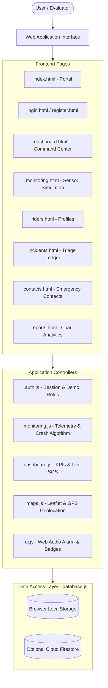

# Smart Helmet Emergency Alert System — Software Version

A complete, responsive, hardware-free web application that simulates a smart motorcycle helmet accident detection and emergency dispatch system. Built with vanilla HTML5, CSS3, JavaScript, Leaflet (OpenStreetMap), and Chart.js, featuring persistent LocalStorage demo mode and pluggable Firebase Authentication & Cloud Firestore support.

---

## Table of Contents
1. [Project Overview](#project-overview)
2. [Key Objectives](#key-objectives)
3. [Features](#features)
4. [Technology Stack](#technology-stack)
5. [System Architecture](#system-architecture)
6. [Database Structure & Data Models](#database-structure--data-models)
7. [Installation & Local Setup](#installation--local-setup)
8. [Demonstration Guide (Evaluator Friendly)](#demonstration-guide-evaluator-friendly)
9. [Firebase Setup & Configuration](#firebase-setup--configuration)
10. [Deployment Guide](#deployment-guide)
11. [Limitations](#limitations)
12. [Future Enhancements](#future-enhancements)
13. [Academic Project Report Outline](#academic-project-report-outline)

---

## 1. Project Overview

Motorcycle accidents often occur in remote or high-speed transit corridors where prompt medical dispatch is the primary factor determining survival. Physical smart helmet prototypes require microcontrollers (ESP32 / Arduino), 3-axis accelerometers (MPU6050), GPS modules (NEO-6M), and GSM cellular units.

The **Smart Helmet Emergency Alert System (Software Version)** replicates this entire ecosystem algorithmically in software without requiring any physical sensors or hardware. It simulates G-force impact shockwaves, sudden deceleration, helmet-wearing infrared proximity, and browser-based geolocation mapping with real-time triage workflows.

---

## 2. Key Objectives

- **Zero-Hardware Simulation**: Demonstrate how a sensor-enabled helmet detects collisions without buying or soldering microcontrollers.
- **Accident Detection & Telemetry**: Algorithmically generate tri-axial acceleration ($X, Y, Z$) and resultant $G$-force vectors with emergency crash thresholds ($> 4.0G$).
- **Emergency Dispatch & Geolocation**: Capture real-world browser coordinates via the HTML5 Geolocation API (with simulated coordinate fallbacks) and plot incidents on OpenStreetMap using Leaflet.
- **Emergency Contact Notification Workflow**: Provide 1-click calling (`tel:`) and pre-filled emergency distress SMS generation (`sms:`) for registered family contacts and paramedic units.
- **Persistent Data Store**: Operate out of the box with `localStorage` and offer seamless scalability with Firebase Authentication and Cloud Firestore.

---

## 3. Features

### A. Authentication & Session Management (`login.html`, `register.html`)
- Email & password validation.
- 1-Click Evaluator Quick Logins:
  - **Emergency Dispatch Officer** (HQ monitoring console).
  - **Demo Motorcyclist Rider** (Alex Johnson).
- Firebase Auth ready (toggle in `js/auth.js`).

### B. Command Dashboard (`dashboard.html`)
- **Key Performance Indicators (KPIs)**: Total Registered Riders, Total Accidents, Active Alerts, Resolved Incidents, and Connected Helmet Status.
- **Prominent SOS Panic Button**: Radar-pulsing emergency button with modal confirmation and location capture.
- **Live Leaflet Incident Map**: Real-time pins color-coded by incident status (Red = New, Amber = Acknowledged, Purple = Assistance Dispatched, Green = Resolved).
- **Chart.js Severity Breakdown**: Doughnut chart calculated from active application records.
- **Recent Incidents Table & Audit Log Stream**: Live audit trail of system events.
- **Demo Data Controls**: 1-click restore to original seed data or clean database wipe.

### C. Helmet Monitoring Console (`monitoring.html`)
- **Real-Time Telemetry Stream**: Tri-axial accelerometer ($X, Y, Z$), velocity (km/h), and resultant $G$-force vector ($\sqrt{X^2 + Y^2 + Z^2}$).
- **Proximity & Wireless Toggles**: Simulate helmet being worn on head vs. removed, and wireless link connected vs. disconnected.
- **Controlled Accident Simulation**: Generates sudden deceleration and a sharp impact spike ($5.5G - 7.5G$), triggers an audible alarm beep via the Web Audio API, records browser coordinates, and opens a triage modal.
- **Automated Timer Cleanup**: Clean cancellation of interval timers on stop or page unload.

### D. Rider Profile Management (`riders.html`)
- Full CRUD operations for riders: Name, Phone, Helmet Hardware ID, Blood Group, and Primary Emergency Contact.
- Blood group filter and search bar.
- Form validation and confirmation dialogs.

### E. Incident History & Triage (`incidents.html`)
- Multi-criteria filtering by Date Range, Collision Type, Severity, and Status.
- Triage modal with an embedded Leaflet location map and direct "Open in Google Maps" link.
- Status lifecycle workflow: `New` $\rightarrow$ `Alert Acknowledged` $\rightarrow$ `Assistance Required` $\rightarrow$ `Resolved`.
- Export incident records to CSV.

### F. Emergency Contact Management (`contacts.html`)
- Contact cards with relationship details, primary contact designation, and notes.
- Direct **Click-to-Call** link (`tel:...`).
- Direct **Draft Emergency SMS** button with modal disclosure notice and pre-filled message (`sms:...`).

### G. Reports & Safety Analytics (`reports.html`)
- Calculated from live records in storage:
  - Incident Frequency Trend Line Chart.
  - Severity Proportion Doughnut Chart.
  - Incident Type Distribution Bar Chart.
  - Rider-Wise Incident Audit Table.
- Filter by All-Time, 7 Days, 30 Days, or 90 Days.
- Export analytics summary to CSV.

---

## 4. Technology Stack

| Layer | Technologies |
|---|---|
| **Frontend Structure** | HTML5, Semantic Elements |
| **Styling & Theme** | Vanilla CSS3 (Custom Properties, Dark Road-Safety Navy Palette `#0a0f1d`, Glassmorphism, Micro-Animations) |
| **Responsive Design** | Custom CSS media queries for desktop, tablet, and mobile off-canvas drawer |
| **Logic & State** | Pure Vanilla JavaScript (ES6+ Modules, Data Access Layer abstraction) |
| **Maps** | Leaflet 1.9.4 + OpenStreetMap CartoDB Tiles (with Geolocation API) |
| **Charts** | Chart.js 4.4.1 |
| **Icons & Typography** | Font Awesome 6.5.1, Google Fonts (*Inter* & *JetBrains Mono*) |
| **Audio Synthesizer** | HTML5 Web Audio API (offline emergency alarm tone) |
| **Persistence** | Browser `localStorage` (default demo) / Firebase Firestore (pluggable) |

---

## 5. System Architecture



---

## 6. Database Structure & Data Models

### 1. `riders` Collection
```json
{
  "id": "RDR-1001",
  "name": "Alex Johnson",
  "phone": "+1 (555) 234-5678",
  "emergencyContact": "Sarah Johnson (Spouse)",
  "emergencyPhone": "+1 (555) 876-5432",
  "helmetId": "HLM-8088",
  "bloodGroup": "O+",
  "medicalNotes": "No known allergies. Carries asthma inhaler.",
  "status": "Active",
  "createdAt": "2026-03-15T09:30:00Z"
}
```

### 2. `helmets` Collection
```json
{
  "id": "HLM-8088",
  "riderId": "RDR-1001",
  "model": "AeroShield Pro V2",
  "batteryLevel": 88,
  "isConnected": true,
  "isWorn": true,
  "lastHeartbeat": "2026-10-17T08:30:00Z"
}
```

### 3. `incidents` Collection
```json
{
  "id": "INC-2026-001",
  "riderId": "RDR-1001",
  "riderName": "Alex Johnson",
  "type": "High Impact Collision",
  "severity": "Critical",
  "timestamp": "2026-10-15T12:00:00Z",
  "lat": 37.7749,
  "lng": -122.4194,
  "locationName": "Market St & 4th Ave, San Francisco, CA",
  "locationSource": "Live Browser GPS",
  "status": "Resolved",
  "notes": "Simulated impact: 6.8G. Paramedics dispatched.",
  "isSimulated": true,
  "sensorReading": {
    "gForce": 6.8,
    "speed": 0,
    "angle": 78
  }
}
```

### 4. `contacts` Collection
```json
{
  "id": "CTC-01",
  "name": "Sarah Johnson",
  "relationship": "Spouse",
  "phone": "+1 (555) 876-5432",
  "email": "sarah.j@example.com",
  "isPrimary": true,
  "notes": "Default primary emergency contact for Alex"
}
```

### 5. `activityLogs` Collection
```json
{
  "id": "LOG-179222",
  "timestamp": "2026-10-17T08:30:00Z",
  "type": "EMERGENCY_SOS",
  "description": "Manual SOS Triggered for Alex Johnson [INC-2026-001]",
  "icon": "fa-triangle-exclamation",
  "color": "danger"
}
```

---

## 7. Installation & Local Setup

The application uses standard web technologies and runs out of the box with any local HTTP server.

### Option A: Using Python (Recommended)
Open a terminal in the project directory:
```bash
python -m http.server 8000
```
Open your browser and navigate to:
```
http://localhost:8000/index.html
```

### Option B: Using Node.js
If you have `npx` installed:
```bash
npx serve -l 8000 .
```

### Option C: VS Code Live Server
Right-click `index.html` in Visual Studio Code and choose **Open with Live Server**.

---

## 8. Demonstration Guide (Evaluator Friendly)

To demonstrate the full feature set to an evaluator or teacher:

1. **Open Landing Page** (`index.html`):
   - Review the project overview, hardware-free architecture, and system preview.
   - Click **Open Dashboard**.

2. **Command Dashboard** (`dashboard.html`):
   - Review live KPIs (Total Riders, Total Accidents, Active Alerts, Resolved Incidents).
   - Observe the interactive Leaflet map showing color-coded incident pins.
   - Click the prominent **EMERGENCY SOS** button.
   - Observe that the confirmation modal captures browser coordinates (or uses fallbacks) and links the selected rider.
   - Click **Confirm & Dispatch SOS**.
   - Listen to the audio alarm tone synthesized via Web Audio API, notice the red screen pulse, and observe the new incident badge appearing on the dashboard.

3. **Sensor Telemetry Simulator** (`monitoring.html`):
   - Click **Start Monitoring**.
   - Watch the tri-axial accelerometer bars ($X, Y, Z$) and resultant $G$-force fluctuate in real time.
   - Toggle **Wireless Link** or **Infrared Wear Status** to simulate helmet detachment.
   - Click **Simulate Accident**.
   - Notice the impact shockwave spike ($> 5.5G$) and the emergency modal.
   - Click **Mark Resolved** to complete the triage cycle.
   - Click **Stop Monitoring** to halt the timer.

4. **Rider Profile Management** (`riders.html`):
   - Click **Add New Rider**.
   - Enter details (e.g., Name: `Carlos Mendoza`, Phone: `+1 555-456-7890`, Helmet: `HLM-9912`, Blood: `O+`).
   - Click **Save Rider Profile** and see it instantly appear in the table.

5. **Incident History & Triage** (`incidents.html`):
   - Filter by Severity (`Critical`) or Status (`New`).
   - Click **Triage** on any incident to inspect its coordinates on the embedded map and click the direct Google Maps link.
   - Change the status dropdown from `New` to `Assistance Required` or `Resolved`.
   - Click **Export to CSV** to download the ledger.

6. **Emergency Contacts** (`contacts.html`):
   - Test the **Call Contact** button (`tel:`).
   - Click **Draft SMS** to preview the pre-filled emergency distress text and review the browser security disclosure.

7. **Reports & Analytics** (`reports.html`):
   - View the dynamic Incident Frequency Trend Line, Severity Proportion Doughnut, and Incident Type Distribution Bar Chart.
   - Change the date filter and click **Export Analytics CSV**.

---

## 9. Firebase Setup & Configuration

To connect this application to real Firebase cloud services:

1. Create a Firebase project at [Firebase Console](https://console.firebase.google.com/).
2. Enable **Authentication** $\rightarrow$ Sign-in method $\rightarrow$ Enable **Email/Password**.
3. Create a **Cloud Firestore** database.
4. Copy `firebase-config.example.js` to `firebase-config.js` and input your keys:
   ```javascript
   const firebaseConfig = {
     apiKey: "AIzaSy...",
     authDomain: "your-app.firebaseapp.com",
     projectId: "your-app",
     storageBucket: "your-app.appspot.com",
     messagingSenderId: "123456789",
     appId: "1:123456789:web:abcdef"
   };
   ```
5. In `js/auth.js`, set `FIREBASE_ENABLED = true;`.

---

## 10. Deployment Guide

### Deploying to Firebase Hosting (Free)
1. Install Firebase CLI:
   ```bash
   npm install -g firebase-tools
   ```
2. Log in and initialize:
   ```bash
   firebase login
   firebase init hosting
   ```
   Select current folder (`.`) as the public directory and configure as a single-page app or static site.
3. Deploy:
   ```bash
   firebase deploy --only hosting
   ```

### Deploying to GitHub Pages, Netlify, or Vercel
Because this is a pure static web application, you can drag and drop this folder directly to [Netlify Drop](https://app.netlify.com/drop) or push to a GitHub repository and turn on **GitHub Pages** under repository settings.

---

## 11. Limitations

1. **Hardware-Free Simulation**: The application runs algorithmic simulations in the browser. It does not interface with physical accelerometers or hardware helmets unless coupled with a serial/BLE Web API extension.
2. **Browser SMS Sandbox**: Web browsers cannot silently transmit cellular SMS messages in the background without user consent. The application pre-fills the distress text via standard `sms:` URIs. Automated background SMS delivery requires a backend gateway (e.g., Twilio or AWS SNS).
3. **Local Demo Authentication**: In default demo mode, session state is preserved in browser `localStorage`. For production security, activate the provided Firebase Authentication adapter.

---

## 12. Future Enhancements

- **Web Bluetooth (WebBLE) Integration**: Connect to physical ESP32 / Arduino microcontrollers via browser Bluetooth.
- **Twilio SMS Webhook**: Forward emergency SOS dispatches to a serverless cloud function (Firebase Cloud Functions) to broadcast live SMS and automated voice calls.
- **Audio Siren Streaming**: Stream live two-way microphone audio between rider helmet headset and dispatcher.
- **PWA Offline Support**: Add Service Worker and web app manifest for installation on Android and iOS devices.

---

## 13. Academic Project Report Outline

*Suitable for final-year engineering and computer science evaluations:*

### 1. Abstract
Presents a software-based emergency accident detection and response system designed to simulate smart helmet IoT capabilities. The system algorithmically evaluates G-force shockwaves, captures user geolocation coordinates, and automates emergency triage workflows.

### 2. Problem Statement
Motorcyclists suffer higher fatality rates during road collisions due to delayed response times ("the golden hour"). While physical IoT helmets exist, prototyping them in educational or testing environments is costly and hardware-dependent. A software-based simulation platform is necessary to validate detection workflows, triage interfaces, and emergency dispatch procedures.

### 3. Objectives
- Implement an accessible, hardware-free simulation platform for smart helmet telemetry.
- Demonstrate threshold-based collision detection logic ($>4.0G$).
- Integrate OpenStreetMap/Leaflet for automated spatial location plotting.
- Establish a complete incident status lifecycle from alert creation to medical resolution.

### 4. System Modules
- **Module 1: Authentication & Role-Based Access** (Operator vs. Motorcyclist).
- **Module 2: Telemetry Generation Engine** (Tri-axial accelerometer simulation).
- **Module 3: Accident Detection & Triage Pipeline** (Impact spike evaluation, audio alert beacon, and coordinate capture).
- **Module 4: Geospatial Mapping Interface** (Leaflet map pins and Google Maps linkage).
- **Module 5: Emergency Contact & Communication Broker** (Click-to-call and pre-filled SMS generator).
- **Module 6: Statistical Analysis & Reporting Engine** (Chart.js trend and severity visualizations).

### 5. Results & Conclusion
Testing confirmed that the simulated crash detection algorithm successfully captured impact spikes, generated persistent incident records, plotted coordinates with Leaflet, and updated analytics without latency. The system proves that road-safety dispatch workflows can be developed and validated in software before committing to embedded hardware manufacturing.

### 6. Future Scope
Integration with embedded MPU6050 sensors, GSM SIM800L cellular modems, and machine learning models for distinguish potholes from true high-speed collision impacts.
